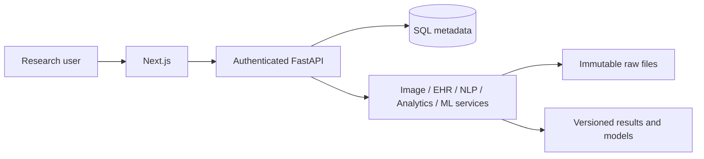

# Architecture

Next.js/React/TypeScript → same-origin /api proxy → FastAPI → validated services → SQLAlchemy → PostgreSQL (Compose) or SQLite (local development). Raw uploads and processed artifacts live outside version control. API token is supplied at runtime and held in browser memory; no patient records or secrets in source. All access except health requires token. An optional environment owner token bootstraps administrator access; named local accounts now enforce roles, scoped data and revocable sessions. This is not production identity/clinical certification.

Dataset metadata records source, license, modality, checksum and owner authorization. Transformations create a new artifact; source is never overwritten. Runs have pending/running/completed/failed state and persist parameters, artifact references and errors. Audit events record resource actions, never clinical note contents. Large files remain in filesystem volumes.

Schema: datasets, runs, audit_events, users, access_sessions, login_throttles, dataset_grants. Runs distinguish imports, transformations, image processing, registrations, inference, training, evaluation, text analytics, forecasting, research and reports. Domain-specific payloads are JSON with explicit run type; named user/session/role/ownership tables now exist; dedicated encounter domain tables, institutional SSO/MFA and production hardening remain future work. Do not import identifiable data into this local research version.

Web CNN jobs use configured server-side source paths, bounded execution and persisted epoch progress; complete artifacts live in storage/models/<run-id>. Explicit selection writes an atomic local pointer only after checksum/preprocessing validation. FHIR imports validate a strict research subset before saving raw bytes. Dataset browsing is read-only; explicit relationships validate keys without rewriting source tables. Inference score retention is opt-in, with no raw-image/Grad-CAM server persistence.

See LOCAL_IDENTITY.md for migration/onboarding, role matrix, model-source administration, grants and scope limits. Existing imports remain administrator-only until explicitly shared; model inference uses administrator-selected research artifacts.
